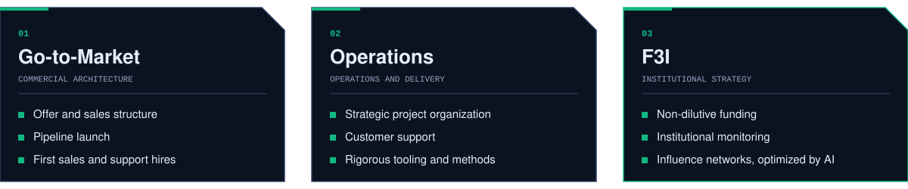
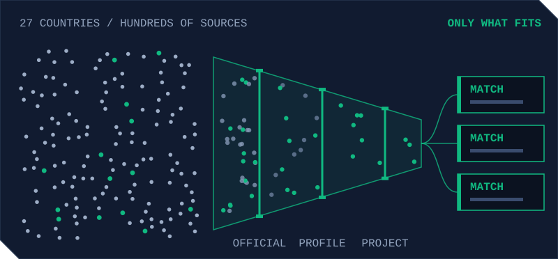
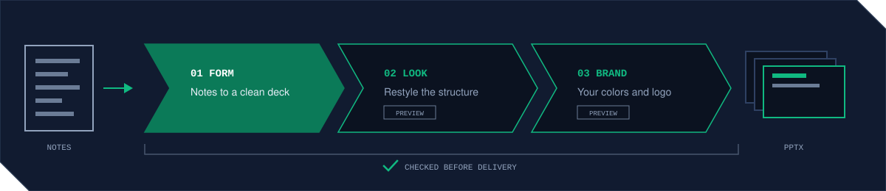
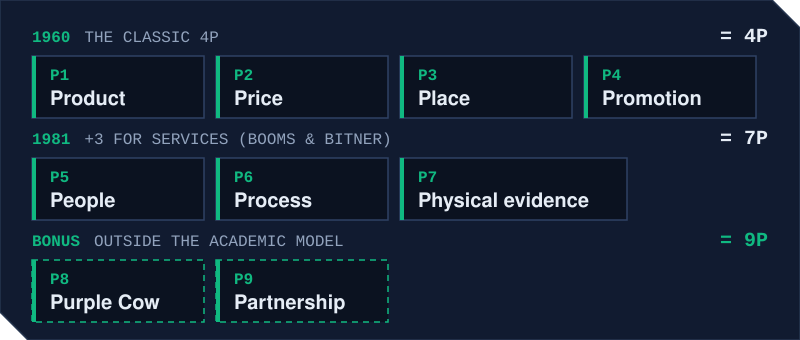
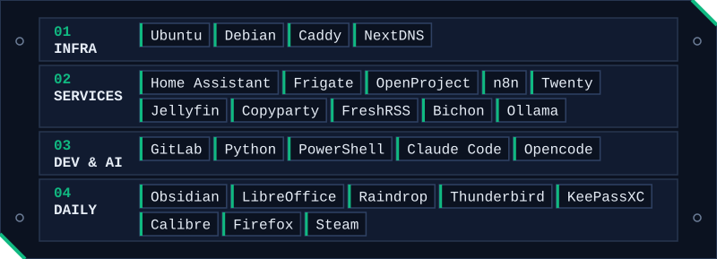

<p align="center">
  
</p>

<p align="left">
  <a href="mailto:maxime@rumpler.fr"></a>
  <a href="mailto:maxime@kairostech.fr"></a>
  <a href="https://t.me/Maxime_Rumpler"></a>
  <a href="https://linkedin.com/in/maximerumpler"></a>
  <a href="https://mastodon.social/@Max__ime"></a>
  <a href="https://substack.com/@maximerumpler"></a>
  <a href="https://kairostech.fr"></a>
</p>

I help founders turn a technical idea into a business that sells. I do it through [KairosTech](https://kairostech.fr): offer, operations, funding. Off the clock I self-host too many services and automate my home.


## KairosTech

> *The backbone behind your innovation.*

I work with tech startups and SMEs on what sits between a working prototype and paying customers: how to sell it, how to deliver it, how to fund it.



<details>
<summary>Offers as text</summary>

- **Go-to-Market**: offer and sales structure, pipeline launch, first sales and support hires.
- **Operations**: strategic project organization, customer support, tooling and methods.
- **F3I**: non-dilutive funding, institutional monitoring, influence networks optimized by AI.

</details>


## F3I: Funding and Institutional Intelligence

> *European public R&D funding exists. Finding it across 27 countries and hundreds of sources is the problem.*

F3I monitors official European and national public sources and surfaces only the opportunities that match an organization's actual profile and research project.



[Live demo](https://f3i.kairostech.fr/share/UXVe89tk1wSNiLZhjFaGu0vji2R43kRtY1ONthSRHAA) · [Request a demo](mailto:contact@kairostech.fr)


## Make_PPTX: agent skills for decks

Give it your notes, get back a PowerPoint deck built from tested slide designs and checked before delivery. Three skills, each doing one job. Use only the ones you need.



| Skill | Role | What it does |
| --- | --- | --- |
| [Make_Clean_PPTX](https://github.com/MaximeRumpler/Make_Clean_PPTX) | Form | Notes in, monochrome deck out. One message per slide, 54 layouts, 81 editable charts, 1,900 icons. |
| [Make_Style_PPTX](https://github.com/MaximeRumpler/Make_PPTX) *(preview)* | Look | Reshapes an existing deck: alternative card shapes, staggered or arced layouts, new backgrounds. |
| [Make_Colors_PPTX](https://github.com/MaximeRumpler/Make_PPTX) *(preview)* | Brand | Applies your exact colors, typography and logo from brand guidelines, a website or reference files. |

Works with Claude Code, Claude.ai, Codex, Cursor, Copilot and Gemini CLI. Outputs stay 100% yours. [Get started](https://github.com/MaximeRumpler/Make_PPTX/blob/main/docs/get-started.md).

<details>
<summary>Quick install</summary>

```bash
# Claude Code
/plugin marketplace add MaximeRumpler/Make_PPTX
/plugin install make-clean-pptx@make-pptx

# Codex, Cursor, Copilot, Gemini CLI
npx skills add MaximeRumpler/Make_Clean_PPTX
```

</details>


## Marketing Mix 9P <sup>FR</sup>



[Marketing Mix 9P](https://maximerumpler.github.io/Marketing_Mix_9P/) rassemble en libre accès (open knowledge) des supports de formation et des grilles d'analyse pour structurer ou auditer un produit ou un service. Du marketing mix classique à 7P jusqu'aux modèles à 9P et 10P, il sert à écrire noir sur blanc la proposition de valeur, le positionnement et le plan de mise sur le marché. Documentation en français pour l'instant, version anglaise prévue.

[Documentation en ligne](https://maximerumpler.github.io/Marketing_Mix_9P/) · [Dépôt GitHub](https://github.com/MaximeRumpler/Marketing_Mix_9P)


## Homelab and home automation

Started with a handful of useful self-hosted services. Now on a mission to bring both KairosTech and my personal life under my own control, as much as possible.



<details>
<summary>Stack as text</summary>

- **Infra and network**: Ubuntu, Debian, Caddy, NextDNS.
- **Self-hosted and ops**: Home Assistant, Frigate, OpenProject, n8n, Twenty, Jellyfin, Copyparty, FreshRSS, Bichon, Ollama.
- **Dev, code and AI**: GitLab, Python, PowerShell, Claude Code, Opencode.
- **Daily stack**: Obsidian, LibreOffice, Raindrop, Thunderbird, KeePassXC, Calibre, Firefox, Steam.

</details>


